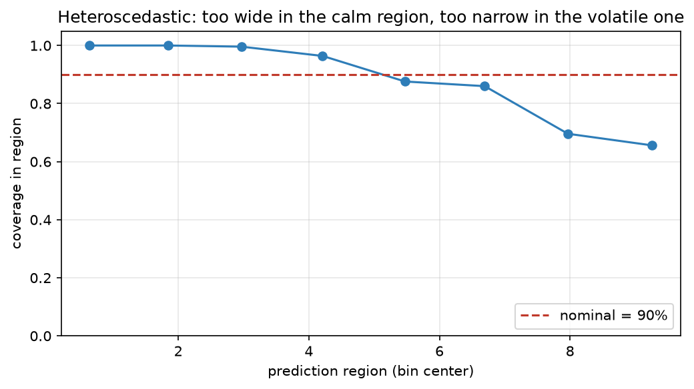
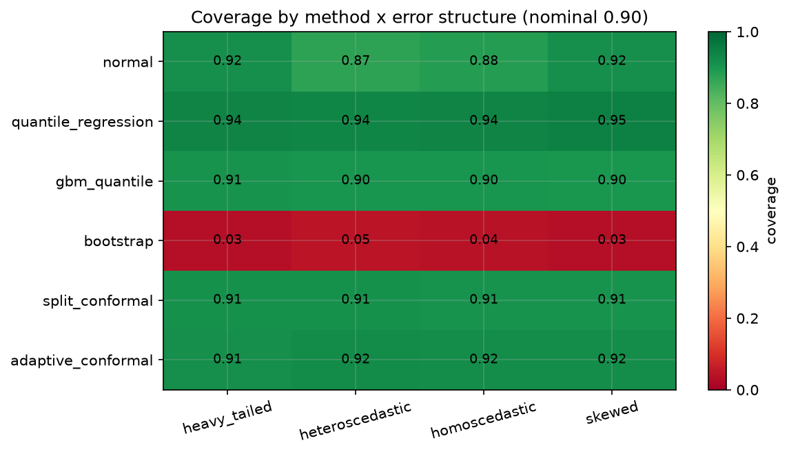

# Prediction Intervals Arena

### Your regression model gives you a number. It should give you a range.

A head-to-head comparison of **five ways to put an honest uncertainty range on a regression
prediction** — a normal-theory interval, quantile regression, native gradient-boosting
quantiles, bootstrap intervals, and conformal prediction — judged by the one metric that
matters: **coverage**. Does the 90% interval actually contain the truth 90% of the time, on
held-out data, measured against known truth?

> **The claim.** The textbook interval quietly assumes **constant, symmetric, normal** errors.
> Real data breaks all three. Under heteroscedasticity its single constant width covers only
> **~66% of the truth in the volatile region** (while ballooning to ~100% in the calm region) —
> false confidence exactly where the stakes are highest. **Conformal prediction** hits its
> promised rate on *any* model and *any* data, with a distribution-free guarantee, in a few
> lines of code — and almost nobody uses it.

Everything runs on a **2-CPU / 8 GB GitHub Codespace, no GPU**. Methods are built **from
scratch** so you can see how each one works, not just import it.

---

## The failure, in one picture

The normal interval's *overall* coverage on heteroscedastic data looks only slightly low
(0.88). The real tell is **conditional** coverage — coverage within regions of the prediction:



*Too wide in the calm region (over-covering, ~100%), far too narrow in the volatile region
(under-covering, ~66%). A single constant width cannot be right everywhere.*

---

## The scoreboard

Empirical coverage on held-out data, nominal **0.90**, across four error structures
(`notebooks/05_arena.ipynb`):

| Method | Homoscedastic | Heteroscedastic | Skewed | Heavy-tailed |
|---|:--:|:--:|:--:|:--:|
| Normal (textbook) | 0.88 | 0.87 | 0.92 | 0.92 |
| Quantile regression | 0.94 | 0.94 | 0.95 | 0.94 |
| GBM quantiles | 0.90 | 0.90 | 0.90 | 0.91 |
| Bootstrap | 0.04 | 0.05 | 0.03 | 0.03 |
| **Split conformal** | **0.91** | **0.91** | **0.91** | **0.91** |
| **Adaptive conformal** | **0.92** | **0.92** | **0.92** | **0.91** |



- **Split conformal** lands on nominal everywhere — that is the guarantee at work.
- **Adaptive (Mondrian) conformal** keeps the guarantee *and* varies width by region, giving
  the best coverage/tightness trade-off.
- **Quantile methods** cover well but carry no guarantee and can drift above nominal.
- **Bootstrap** collapses: plain bootstrap captures uncertainty in the *estimate*, not the full
  *predictive* uncertainty — the arena measures that honestly.
- Over 15 seeded repeats on heteroscedastic data, normal coverage averages **0.87** (down to
  0.85) while split conformal averages **0.90** — the qualitative result is robust, not a fluke.

---

## The five methods

| Method | Idea | Width | Guarantee |
|---|---|:--:|:--:|
| Normal-theory | `prediction ± z·residual_std`, one constant width | constant | ✗ |
| Quantile regression | predict the 5th/95th percentiles via the **pinball loss** (from scratch) | varies | ✗ |
| GBM quantiles | a gradient booster's built-in quantile objective, one model per bound | varies | ✗ |
| Bootstrap | resample, refit, take the spread of predictions | varies | ✗ |
| **Split conformal** | calibrate on held-out errors, wrap **any** model, **no retraining** | constant | ✓ |
| **Adaptive conformal** | the conformal quantile *per region* — width varies, guarantee kept | varies | ✓ |

---

## Quickstart

```bash
make setup       # install uv, sync deps, register the Jupyter kernel
make test        # run the test suite (the thesis, asserted)
make notebooks   # execute all six notebooks, refreshing outputs/
make run         # launch the Streamlit app on :8501
```

`make ci` runs `sync + lint + test`. Everything goes through `uv`; Python 3.11+.

### The Streamlit app

1. **Interval viewer** — pick an error structure and method, see the band.
2. **Coverage meter** — actual vs the promised 90% on held-out data.
3. **Assumption breaker** — crank the noise and watch the normal interval collapse while conformal holds.
4. **Wrap-my-model** — split conformal wrapped around a pre-fit model, no retraining.

---

## Notebooks

| # | Notebook | What it shows |
|---|---|---|
| 01 | [A Number Is Not Enough](notebooks/01_a_number_is_not_enough.ipynb) | The decision a single number can't support; coverage as the metric. |
| 02 | [The Textbook Interval and Why It Fails](notebooks/02_the_textbook_interval_and_why_it_fails.ipynb) *(showpiece)* | Normal interval works on homoscedastic data, breaks on heteroscedastic/skewed. |
| 03 | [Quantile Methods](notebooks/03_quantile_methods.ipynb) | Pinball quantile regression + GBM quantiles recover varying width. |
| 04 | [Conformal Prediction](notebooks/04_conformal_prediction.ipynb) *(payoff)* | Split conformal wraps any model; adaptive conformal varies width, keeps the guarantee. |
| 05 | [The Arena](notebooks/05_arena.ipynb) | All methods × all structures, scored on coverage and efficiency. |
| 06 | [Decision Framework](notebooks/06_decision_framework.ipynb) | Which method to use when, and a `coverage_report` you run on your own data. |

Each notebook runs in seconds on the 2-CPU box. Every figure is saved to
[`outputs/figures/`](outputs/figures/) as PNG and every numeric/text result to
[`outputs/data/`](outputs/data/) as JSON, so results are reproducible and quotable without
re-running anything.

---

## Repository layout

```
config/settings.yaml      # coverage levels, seeds, data sizes (single source of truth)
src/
  config.py               # pydantic-settings loader
  intervals/              # the five methods, from scratch (+ base helpers)
  datasets/synthetic.py   # homoscedastic / heteroscedastic / skewed / heavy-tailed, known truth
  evaluation/             # coverage, width, conditional coverage, the arena harness
  visualisation.py        # matplotlib helpers
  artifacts.py            # save_fig -> PNG, save_json -> JSON
app/streamlit_app.py
notebooks/                # 01–06
tests/                    # the thesis, asserted (see below)
outputs/figures/ · outputs/data/
```

---

## Tests encode the thesis

`make test` must pass with zero errors; the suite asserts the headline claims, not just shows them:

- **`test_conformal.py`** — split conformal hits nominal (±0.05) on every error structure, and
  when **wrapped around a pre-fit model**; adaptive conformal keeps coverage *and* varies width.
- **`test_normal_undercovers.py`** — the normal interval is near-nominal with flat conditional
  coverage on homoscedastic data, but under heteroscedasticity its overall coverage drops below
  nominal and its **volatile-region coverage collapses below 0.75** while the calm region
  over-covers — and it covers less than conformal.
- **`test_intervals.py` / `test_coverage.py`** — every method yields valid intervals; the
  evaluators are correct against known truth.

---

## Related projects

Part of a family of honest, from-scratch ML/stats arenas by
[@Dima806](https://github.com/Dima806):

- **[calibration_arena](https://github.com/Dima806/calibration_arena)** — the classification
  twin. Calibration is to predicted probabilities what coverage is to regression intervals, and
  just as neglected.
- **[bootstrap_101](https://github.com/Dima806/bootstrap_101)** — the bootstrap from the ground
  up; it is one of the five interval methods compared here.
- **[forecasting_arena](https://github.com/Dima806/forecasting_arena)** — head-to-head
  forecasting approaches: prediction intervals on the time axis, where conformal's exchangeability
  assumption needs care.
- **[threshold_lab](https://github.com/Dima806/threshold_lab)** — turning model outputs into
  decisions by choosing thresholds, the downstream an honest interval feeds.
- **[bayesian_stats_101](https://github.com/Dima806/bayesian_stats_101)** — Bayesian credible
  intervals, the probabilistic route to uncertainty that complements this frequentist, coverage-first lens.

---

## References

- Angelopoulos & Bates (2021), *A Gentle Introduction to Conformal Prediction* (arXiv:2107.07511).
- Lei et al. (2018), *Distribution-Free Predictive Inference for Regression*, JASA.
- Romano, Patterson & Candès (2019), *Conformalized Quantile Regression*, NeurIPS.
- Koenker & Bassett (1978), *Regression Quantiles*, Econometrica.
- Vovk, Gammerman & Shafer (2005), *Algorithmic Learning in a Random World*, Springer.

## License

[Apache-2.0](LICENSE).
